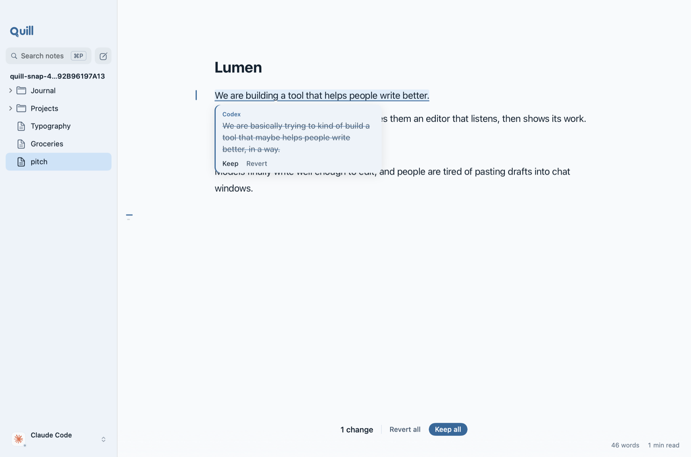
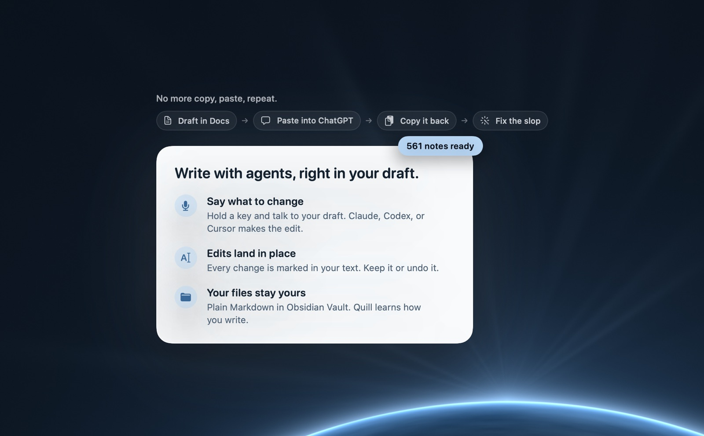

<p align="center">
  <picture>
    <source media="(prefers-color-scheme: dark)" srcset=".github/assets/banner-dark.svg">
    
  </picture>
</p>

<p align="center">A Markdown editor for the Mac. AI co-writers edit your draft in place, and you keep or revert each change.</p>

<p align="center">
  
  
  <a href="https://github.com/hridaya423/quill/releases/latest"></a>
</p>

<p align="center">
  <a href="https://github.com/hridaya423/quill/releases/latest/download/Quill.dmg"><b>Download for Mac</b></a> · <a href="https://github.com/hridaya423/quill/releases">Releases</a> · <a href="https://github.com/hridaya423/quill/issues">Issues</a>
</p>

Quill keeps your notes as plain `.md` files in one folder, so Obsidian and other editors open them too. Hold the right ⌥ key and say a change, or press ⌘K and type it. Claude Code, Codex, Cursor, and seven other agents use their own sign-in, so the plan you already pay for works.

<p align="center">
  
</p>
<p align="center"><sub>A change in review. The card names the co-writer that made it and shows the words it replaced.</sub></p>

## Install

Quill needs macOS 26 or later.

1. Download [Quill.dmg](https://github.com/hridaya423/quill/releases/latest/download/Quill.dmg) from the latest release.
2. Open the DMG and drag Quill into Applications.
3. Open Quill. To talk to it, allow microphone and speech recognition access.

Apple notarized the app, so Gatekeeper opens it with no warning.

To build from source, install Swift 6.2 or later and run:

```sh
scripts/bundle.sh release
open build/Quill.app
```

To build a signed, notarized installer, run:

```sh
scripts/notarize.sh
```

The script builds `build/Quill.dmg` and submits it to Apple. It needs a Developer ID Application certificate in your keychain and a `notarytool` keychain profile named `notary`.

## Quickstart

1. Open Quill. The first run plays a short film, then asks four questions.
2. Pick the folder you write in. Quill counts its notes and offers to learn your voice from them.
3. Pick a co-writer. Press + on other co-writers to also ask them.
4. Quill opens a practice note with a draft email. Hold the right ⌥ key and say "make it direct".

The co-writer strikes the hedges and types the new words in. Press ⌘↩︎ to keep the change, or ⌘⌫ to revert it.

<p align="center">
  
</p>

## Usage

### Ask

| Key | Action |
|---|---|
| Hold right ⌥ | Talk. Let go to send. |
| ⌘K | Type a request |
| ⇧⌘K | Start or stop talking without holding a key |
| ⌘. | Stop the co-writer |
| ⌘P | Search notes |

Select text first to make "this" mean the selection. Paste a link into the note or the request, and Quill reads the page for every co-writer. Google Docs, Sheets, and Slides open through their text export, so the document must be shared with anyone who has the link.

### Review

| Key | Action |
|---|---|
| ⌘↩︎ | Keep the change at the caret |
| ⌘⌫ | Revert the change at the caret |
| ⇧⌘↩︎ | Keep all changes |
| ⇧⌘⌫ | Revert all changes |
| ⌘] and ⌘[ | Next and previous change |
| ⌘Z | Undo the whole request |

### Fill an outline

Write the outline you want, with blank bullets or empty labels such as `Pros:` and `Cons:`. Ask the co-writer to fill it in. It fills the empty slots in place and keeps your own entries word for word.

### Ask several co-writers

Open the co-writer badge menu and choose **Also Ask**, or use Settings, Co-writers. Each co-writer you add answers every edit request alongside the lead. Quill stacks their answers in the note under your entries. Each change names its author. If one co-writer fails, the reply says why.

### Modes

| Mode | Key | What the co-writer does |
|---|---|---|
| Guided edits | ⌃⌘1 | Edits the text. A question gets an answer and no edits. |
| Margin notes | ⌃⌘2 | Leaves up to five notes in the margin. Click a note to apply it. |

## Co-writers

| Co-writer | Needs |
|---|---|
| Claude Code | Node, from nodejs.org |
| Codex | `npm install -g @openai/codex`, signed in |
| Cursor | Downloads on first use. Sign in with `cursor-agent login`. |
| Gemini CLI | Node, from nodejs.org |
| Grok Build | Node, from nodejs.org |
| OpenCode | Downloads on first use |
| Antigravity | Downloads on first use |
| Devin | Downloads on first use. Sign in with `devin auth login`. |
| Pi | `npm install -g @mariozechner/pi-coding-agent` |
| fx | The `fx` CLI, signed in with `fx login` |
| Your API | Any OpenAI-compatible URL and key, or an Anthropic URL |

Quill downloads registry co-writers once, checks each download against its SHA-256 hash, and keeps it in Application Support.

## Configuration

| Variable | Default | Meaning |
|---|---|---|
| `QUILL_VAULT` | `~/Quill` | The notes folder. Onboarding and Settings also set it. |
| `QUILL_SUPPORT` | `~/Library/Application Support/Quill` | Working copies, the request ledger, and the practice note |
| `QUILL_DEFAULTS` | standard defaults | A separate defaults suite, for tests and trial runs |
| `QUILL_API_URL` | none | The URL for the Your API co-writer |
| `QUILL_API_KEY` | none | The key for the Your API co-writer, if the Keychain has none |
| `QUILL_IDENTITY` | `Developer ID Application` | The signing identity for `scripts/notarize.sh` |
| `QUILL_NOTARY` | `notary` | The `notarytool` keychain profile for `scripts/notarize.sh` |

Quill keeps `Voice.md` in your notes folder. The "My rules" section belongs to you, and Quill never changes it. Quill adds what it learns from the changes you keep and revert.

## How it works

Each co-writer edits a working copy of the note in Application Support, never the note itself. Quill compares the copy with your text and plays each difference into the editor as a pending change. When several co-writers answer, Quill merges their copies line by line before review. Quill checks each answer for stock AI phrases. If it finds one, it asks the co-writer to rewrite once.

## Development

```sh
scripts/test.sh
```

The script runs the app and core test suites against a throwaway defaults suite and support folder.

| Command | What it does |
|---|---|
| `QUILL_SNAPSHOTS=<dir> scripts/test.sh --filter Snapshots` | Renders every app and onboarding state, light and dark, to PNG files |
| `cd web && node build.mjs` | Builds the CodeMirror editor into `Sources/Quill/Brand/Editor` |
| `scripts/icon.sh` | Regenerates the mark, the app icon, and the installer background from `assets/brand` |
| `python3 scripts/palette.py` | Checks APCA contrast and that the app and editor palettes match |
| `QUILL_CREW=1 scripts/test.sh --filter liveCrewFills` | Runs a live Claude Code and Codex request that fills an outline from a Luma link |

Design notes live in [`docs/design`](docs/design), and the plan history in [`docs/plans`](docs/plans). Progress and evidence for each change live in [`progress.md`](progress.md).
