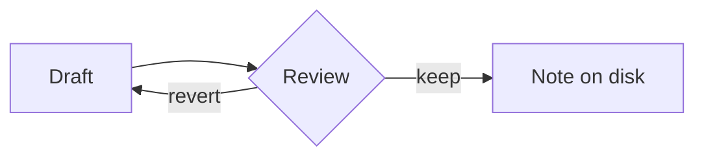

# Kitchen sink

A paragraph with a [[Sources|wikilink]], a ==highlight==, a #tag, a footnote[^1], and an inline formula $e^{i\pi} + 1 = 0$. %%a hidden comment%% The end. ^intro

> [!note] A plain note
> Callouts hold an aside. They can span lines.

> [!warning]
> No title, so the type names it.

> [!tip]- Folded tip
> You only see this when it's open.

$$
\int_0^1 x^2\,dx = \frac{1}{3}
$$

![[Sources#Why]]

![[diagram.svg|240]]

![[Missing note]]

%%
A block comment
across two lines
%%

[^1]: The footnote text.
